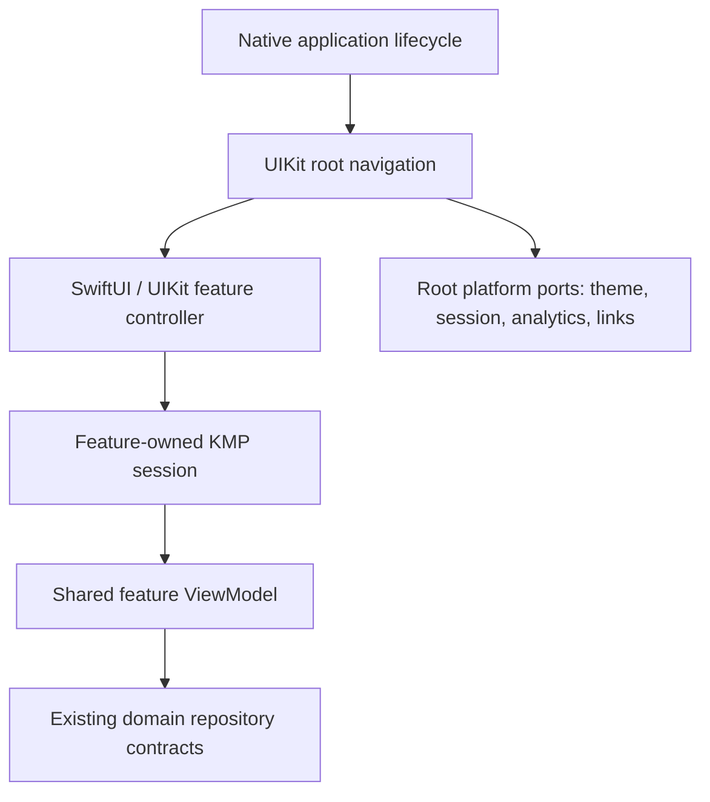

# iOS native exit — 2026-11-25

Status: native implementation connected; final integration/verification in progress. The owner requested completion of the remaining
items in `IOS_NATIVE_UI_AUDIT_2026_11_25.md`, including the containers.

Owner clarification: data, business logic and ViewModels stay in Kotlin/KMP;
all active application UI, navigation and modal containers must be SwiftUI/UIKit.
Build 3228 is a visible-UI checkpoint and does not satisfy the complete target.
Root/route Compose hosts are required remaining work, not an accepted final state.

Current root continuation supersedes the historical checkpoint statuses below:
`MainViewController` constructs `IosNativeRoot` directly. Swift owns tabs, pushed
controllers, headers, modal presentation and UIKit transition completion. The old
Compose root/route controller and navigation memory were removed. Ordinary
constructor-injected destinations retain feature-owned Kotlin sessions. A repeated
read-only reachability audit found no active Compose UI destination or modal in
either launcher; shared Android UI and unused platform adapters are not selected.
This is static reachability evidence, not device acceptance or a release claim.

Delivery instruction (owner, 2026-11-25): upload the resulting version to
TestFlight after all requested fixes are finished. Use the existing
`.github/workflows/ios-testflight.yml` archive/sign/upload pipeline for
`com.coffeepeek`; the locally signed `com.coffeepeek.xcross` Debug package is a
separate device-verification artifact. The current workflow permits main and a
manual dispatch from codex/ios-native. Do not dispatch an unfinished checkpoint
or describe workflow dispatch as a completed upload/Apple processing.

## Decision and ownership

Keep the existing KMP repositories, account guards and feature ViewModels. Move
remaining presentation to SwiftUI/UIKit and make feature sessions explicitly owned
by their native controller. Application composition owns native root navigation,
global modal arbitration, platform configuration and adapters. No new Gradle
modules, dependencies or second application are needed.

This replaces implicit composition lifetime with explicit start/observe/close.
Cancellation must stop observations and media work. An account change must clear
private state and prevent late results. Native modal dismissal and model disposal
must each run once, including interactive dismissal and account invalidation.

## Checkpoints and acceptance

1. Collections membership and quick creation: reuse SavedCollectionsViewModel,
   account revisions, membership validation, decorated repository analytics and
   favorite synchronization. Native search, grouped lists, errors, retry, keyboard,
   cancellation, busy guards and quick-create validation must remain available.
2. Author operation status: replace the last visible Compose contour with the
   existing native contour loader; preserve accessibility and operation lifetime.
3. Native modal paths: Home create/edit, brew from shelf, community edit/report,
   ownership claim and snackbar placement. Retire the old iOS wrapper when its
   last active consumer has been replaced. Common Android UI remains supported.
4. Root and route bootstrap: extract plain feature session factories before
   removing Compose roots. Preserve foreground work, update/guest prompts, theme,
   language, navigation/deep links, consent and analytics visibility ownership.
   A native screen embedded in a Compose root does not satisfy this checkpoint.

## Verification

Use feature unit/contract tests for request races, account changes, close and
failure recovery. Compile affected shared and iOS modules; assemble Android
directDebug including packaged DEX checks with `--max-workers=6`. Do not add UI or
screenshot automation. Add colocated light/dark previews for native components.
Build and sign the native application only after sources are frozen; install an
in-place update on the previously agreed USB iPhone when available. Manual checks
must cover light/dark, larger text, safe areas, keyboard, swipe/back/cancel and
modal placement without real-account writes. Compilation, previews and fake
contracts do not certify device behavior or live persistence.

## Risks and alternatives

Removing MainViewController alone would lose composition-owned session, theme,
foreground and navigation collectors. Keeping a transparent Compose root would
hide rather than finish the container migration. Reimplementing repository logic
in Swift would fork account/concurrency rules. The selected incremental session
approach preserves the shared behavior, at the cost of explicit lifetime adapters.

## Evidence

- Implemented native membership/quick creation, native contour factory, Home
  full-screen presentation, plain native shelf-brew lifetime, plain ownership
  claim lifetime, native community sheets, feed/header placement and messages.
- Shared verification: collections 88 tests / 6 suites; community 72 / 7;
  ownership 25 / 4; application modal/global-flow contracts 31 / 4; native
  Home session 7 / 1. Total: 223 executed Kotlin contracts, no failures.
  Android directDebug assembled and packaged runtime class checks passed.
  Function-body gate: 128 recorded, 0 new; baseline only shrank.
- An ordinary Windows `:composeApp:compileKotlinIosArm64` was SKIPPED, so it is
  not evidence of application iOS compilation. The xcross 3228 build is the
  required application compile/link gate. The final 3228 build passed Kotlin,
  framework linking and SwiftUI, was signed, and was not installed because the
  provisioned USB device was absent. Subsequent root/session changes below are
  newer than that signed artifact and require their own native compile/link gate.
- All 40 Python tooling contracts passed in the final run, including the actual
  Swift photo model compiled with Swift 6 complete strict concurrency. The new
  isolated-deinit pattern also passed standalone strict-concurrency type checking
  with Swift 6.4.2 in the app's current Swift 5 compatibility language mode. This
  does not certify the whole application's conversion to Swift 6 language mode.
- Original failures remain in local logs: one UIKit extension import was fixed;
  registration checks were extended to follow the shared native-controls helper;
  a manifest fixture run during xcross's temporary scannerless rewrite was rerun
  after restoration. The final 40-test run is separate from those failures.
- Root/route CompositionLocal/effect integration remains open. It must not be
  described as a complete removal of Compose runtime or containers. Discovery,
  feed and shop need plain feature-owned sessions before final root removal;
  native view rendering alone does not supply that lifetime API.
- Device UI, accessibility, cancel/back and live backend gates remain untested
  for these changes. No new real-account writes or device settings changes.

### Root/session continuation

- Roaster detail and Business/MyBusiness routes now use direct native controller
  factories. Their existing Kotlin ViewModels have explicit owned stores and
  close hooks; native controller destruction cancels observations and media.
  MyBusiness retains local back handling so an edge pop cannot bypass draft
  confirmation. Full-route account replacement leaves stack reset to the root;
  the short-lived representative claim keeps its separate close-on-revocation.
- Ownership access observation, resume refresh and profile-save revisions are
  plain Kotlin contracts. Android's composition calls the same implementations.
  Saving a native editor updates the same revision observed by shop/roaster
  details. No authorization checks or repository writers moved into Swift.
- RootNavigationLifecycle owns session transitions and one-time guest completion
  outside Compose; NavigatorViewModel now uses its lifecycle viewModelScope.
  Account replacement resets private requests; guest login retains its pending
  check-in handoff; identical root session values keep stack generation.
- Pending notification opens use a cancellable plain collector shared by the
  current host and the future native root. Account readiness, cancellation and
  compare-and-set consumption remain in Kotlin. Native analytics observations
  use the existing service/consent and exposure ledger, with actual visibility,
  foreground and uninterrupted 500 ms exposure; no second service was created.
- Foreground notification heartbeat now belongs only to App, rather than every
  nested AppContent. It is a structured child of the root lifecycle.
- Verification on 2026-11-25: roaster 31 tests / 4 suites; ownership 30 / 6;
  application root/notification/analytics selection 28 / 6. All passed, with no
  retries of failed assertions. The first application test compilation exposed a
  missing suspend modifier in a test fixture, corrected before the passing run.
  Android directDebug assembly and packaged DEX checks passed; body gate remains
  128 recorded / 0 new. No Android app was installed or launched.

### Swift 6 and native lifetime checkpoint (2026-11-25)

- Main Discovery now selects its owned plain Kotlin session and Swift controller;
  its strings, vector artwork, filter draft and nested roaster transport no longer
  require a feature composition. Discovery contracts passed: 204 tests / 25 suites.
  The check-in picker still needs its separate lease-bound owner.
- Both Xcode application configurations explicitly use Swift 6 and complete strict
  concurrency. The package uses Swift 6 language mode too. Xcode project settings
  were changed through a project model; a model comparison verified that the only
  semantic changes are those two compiler settings.
- UI observable owners and teardown are MainActor isolated. Gallery import,
  cover import, poster export/timeout, refresh and shelf drop handling use owned
  tasks/streams; no application `Task {}`, GCD aggregation or unchecked Sendable
  was introduced. Poster child tasks exchange String/Data, retaining KMP objects
  behind the MainActor request owner.
- Apple begin/cancel and Google begin/sign-out are dispatched by Kotlin to Main.
  Apple cancellation carries the challenge identity and completes platform cleanup
  within the request's structured finally. Nonce/state/nonempty-token checks remain.
  Google SDK callbacks are documented to run on Main in GIDSignIn.h; their missing
  isolation annotation is bridged with a checked MainActor assertion after copying
  the token String. The SDK result object never crosses that boundary.
- OAuth callbacks are single-use MainActor models. There is no singleton OAuth
  AsyncStream or application task queue. Google SDK has no public programmatic
  cancellation API in the installed version; cancelled Kotlin requests ignore late
  replies, while its external UI remains busy until the SDK finishes. This existing
  SDK limitation is not certified by compiler or fake tests.
- Launch readiness retains completion across cancelled waiters. Push uses a fresh
  per-run channel/delegate; closing an old run cannot detach a newer delegate or
  publish a stale SDK result. Permission/account/token acceptance remains in KMP.
- Search matching for collections and shelf beans moved into Kotlin and shares
  Android query semantics. Filtering does not remove membership/library data.
- The constructor registry is now independent of composition. Auth routing has an
  ordinary overload; settings redirects use the parent scope. Other destination
  captures and the actual Compose root are still active.
- Verification: Kotlin/Native application compilation and real framework link
  passed; Swift 6 complete-strict ARM64 executable link passed (module CoffeePeek,
  executable SHA-256 `9bc71bf3c99cc128e1185db1369fcdd3780b3c4eec0927bef35bf858d137d102`).
  Standard Android directDebug/packaged DEX checks and 33 application contracts /
  7 suites passed; collections 89 / 6; home check-in 95 / 7; tooling 42 tests passed,
  including compiled/executed Swift callback, readiness and photo model contracts.
  Body gate: 128 recorded / 0 new. No device was installed or launched.
- Retain earlier failures: full Swift code generation caught isolation issues
  beyond typecheck, fixed before the successful link. Lifetime test fixtures first
  failed to compile due to async assertions/iterator isolation, then were corrected.
  Remaining link warnings concern the existing deprecated Firebase token API and
  the Windows cross-toolchain SDK/linker; there are no concurrency diagnostics.

Community continuation now selects ordinary owned feed/post sessions and direct
native controllers. Resolved copy feeds a single pure card mapper; native drafts,
photo/message lifetimes, analytics and bounded prefetch no longer need composition.
All root tabs require native content. Old feed/detail/form renderer hooks and the
root-tab fallback content were removed; the Compose root/navigation itself remains.
Kotlin/Native compilation passed after removal. The actual Swift 6 complete-strict
ARM64 executable linked successfully (SHA-256
`c643bffec5db0e954c03a85591c798356d7e993a779b4ff5ffa62a71c3a61f1c`).
The subsequent native message fade also passed Swift primary-file object emission.
This executable predates the profile/picker continuation below.

### Profile and picker continuation (2026-11-25)

- Edit profile now uses an ordinary owned feature session/store, direct native
  controller, visibility-bound saved events and native photo picker. The old
  platform renderer hook was removed. Avatar input is copied before the picker
  wipes its buffer; account-flow failure publishes a sanitized snapshot while
  UI observations remain alive. A child photo-import lifetime rejects late
  camera/gallery callbacks after revocation and wipes late uncancellable results.
- Check-in shop selection now has a direct native navigation owner. It retains
  the existing browsing/history leases, recent-shop adapter, Search/Map ViewModels,
  permission counters and one-shot navigation/handoff. Failure/retry can replace
  the lease and dispose the previous source. Native visibility combines actual
  controller visibility with foreground state. The last Compose Discovery/picker
  renderer and platform-content hooks were removed; Android content stays active.
- Native Discovery uses one owned account observation shared by Search/Map. A
  non-cancellation failure revokes the native feature owner, cancels its models
  and is exposed as terminal status. The picker presents native failure/retry
  even when its separate browsing-host observation did not fail. Buffered events
  are checked again at delivery, so terminal failure cannot navigate afterwards.
- Kotlin/Native application compilation passed for these changes. The preceding
  final Android run passed 209 Discovery tests / 25 suites, 92 profile / 9 and 14 app
  navigation/lease/photo contracts / 3, with directDebug assembly and packaged DEX
  checks, including the buffered-event regression. Body
  gate remains 128 recorded / 0 new. Five tooling tests also passed, including
  actual Swift visibility/readiness/push/photo contracts. No device run occurred.
- Preserve the first native compilation failure in local diagnostics: application
  code attempted to import an internal feature resource. It was corrected by an
  ordinary feature-owned localized-title function, without widening Res visibility.
- A fresh framework/full Swift link for this continuation is still required.
  The main Discovery terminal failure/retry presentation must be connected during
  remaining root/session work; exporting the terminal status alone is not native
  root recovery acceptance.

Required next: shop detail and home/editor owners; remaining
constructor-injected destination factories; native global modal
arbitration and Swift root navigation. Do not call this complete native exit.
Device UI, actual OAuth/push/backend behavior and release archive remain separate
gates. No TestFlight upload has been started. The owner authorizes uploading the
final completed version; the existing workflow allows main or manual dispatch from
codex/ios-native. Preserve its guard and reconcile that branch before publishing.

### Native root and remaining feature owners (2026-11-25)

- Shop and Home detail/create/edit now own ordinary feature sessions/stores,
  resource observations and native photo launchers. Revocation sanitizes observed
  form state while subscriptions are alive; linked check-in intent is consumed
  once across rebinding. Main discovery now exposes account-observation failure
  with a native retry that replaces its Search/Map owner.
- Root routing retains existing tabs, auth replacement, deep links, push opens,
  sign-in handoffs and account generations. UIKit acknowledges transitions;
  cancelled swipes retain actual stacks and completed pops release controllers.
  Superseded intents wait for an already started transition; root revocation
  cancels its acknowledgement. Pending links/tabs use expected-value consumption.
- Native root arbitration covers onboarding/update, global loading/errors,
  author operations, collection membership/quick-create and the global check-in
  picker/Home flow. Navigation after a modal waits for actual dismissal; collection
  writes protect dismissal using the current Kotlin busy state. Sources retired
  before UIKit constructs them close without waiting for a nonexistent callback.
- Foreground notification heartbeat, ownership refresh, author refresh, theme and
  language readiness, existing consent/analytics and create exposure remain app
  owned. Session observation failure hides private controllers and offers retry.
- Shop/Home verification before the root continuation: shop 118 tests/12 suites,
  home 99/8 and app 46/6, all passing; Android directDebug packaged DEX checks passed.
  Native application compilation passed. Latest body gate was 126 recorded/0 new.
  The root routing and acknowledgement contracts added afterwards still require
  execution with the final integration. Earlier failures remain in local logs.
- First root framework link passed (58.9 s compilation, 14m33 s framework link).
  Later account/modal guards and incoming native-token rotation are newer than
  that artifact and require regeneration. Swift header verification exposed a
  boxed Kotlin Boolean callback, corrected with its explicit boolValue conversion;
  final complete Swift 6 code generation/link remains open.
- Release now observes the exact uploaded version/build until Apple reports VALID,
  rejected/invalid or a bounded processing timeout. Its six non-UI contracts passed;
  authorization material and API error bodies are not logged. Ruby signing syntax
  and real Apple API use will be checked by the existing release workflow.
- No current device UI run, real-account write or TestFlight upload has occurred.
  Next: retain remote native-token checkpoint, run final contracts/Android/native
  builds and tooling checks, publish the reviewed integration, then run and monitor
  TestFlight archive/upload/Apple processing. No completed release is claimed here.

### Integrated contract verification (2026-11-25)

- Retained native token rotation checkpoint `5c0a92e986c7` by merging it into the
  native-exit branch. Its delayed-login fix is preserved in both the Kotlin root
  lifecycle adapter and native root, including a request arriving after logout.
- Final Kotlin results: 1,606 tests / 262 suites, zero failures/errors/skips across
  application (735), session (39), network (72), auth data (36), shop (118), Home
  (99), discovery (209), community (87), profile (92), collections (89) and ownership
  (30). Android directDebug assembled and packaged runtime classes passed.
- All 43 iOS tooling tests passed, including executed Swift 6 strict lifetime,
  readiness/push ownership, callback and photo-upgrade models. Four release
  versioning tests and six exact-build processing observer tests passed.
- Body limits pass at 125 recorded / zero new. Regeneration removed three obsolete
  entries; it added none. Generate and verify must run in separate Gradle invocations
  because their existing task graph has no dependency for the generated file.
- Preserve earlier failures in local diagnostics: the old photo-picker assertion
  required shared byte ownership and now asserts copied ownership; the Swift test
  extraction boundary was renamed with NativeRootView; the combined baseline
  generation/verification invocation failed Gradle validation. Separate final
  application tests, tooling and body gate passed after those corrections.
- The integrated Kotlin framework compiled and linked (2m04s compilation,
  13m33s framework link). Full Swift 6 complete-strict ARM64 executable code
  generation/link also passed. macOS archive/signing and real Apple processing
  remain required before TestFlight delivery.
- Whole-app Swift 6 complete-strict type checking passed against the integrated
  Kotlin header. Both native root controller and modal presenter passed real
  primary-file ARM64 object emission. The boxed Boolean/void callback adaptations
  are explicit; no Sendable/isolation bypass was added. Remaining warning is the
  existing Firebase token API deprecation; it does not affect the strict-concurrency
  result.

### Local iPhone build checkpoint (2026-11-25)

- Debug 1.2.2 (3229), bundle `com.coffeepeek.xcross`, was packaged from
  `bca0fa47dc1064e309abbc05b7658f5f304b0d44` plus the recorded scanner dependency
  URL change. The local source manifest retains that exact dirty-source identity.
  No Kotlin/Swift runtime source changed after the verified integration.
- Recompiled the complete app with Swift language version 6 and complete strict
  concurrency, then replaced the compatibility-mode CLI executable before signing.
  Unsigned ARM64 executable SHA-256:
  `8868973145cbea3b35f4bd40f7058303ba3f20f8d65fee740c41208dbc4a3783`.
- Existing development profile signing, concrete Keychain groups, bundle signature
  verification and ZIP integrity passed. Signed IPA SHA-256:
  `ac731ae61d5552d87a9fbc0402b26adec67cda2e42694a297973e33969f80e50`.
- Initial installation API enumeration reported no USB device. After the user
  connected/unlocked the agreed iPhone, the API confirmed iPhone15,4 / iOS 27.2.1,
  pairing and unlocked state. In-place installation verified build 3229 and the
  previous development signer; the main `com.coffeepeek` version stayed unchanged.
- CoreDevice launch succeeded and the same process remained running after twelve
  seconds (2026-11-25 18:34:54 UTC). This verifies startup only; screen interactions,
  gestures, accessibility and live OAuth/push/camera/backend behavior are untested.
  The existing Windows xcross build has no scanner; macOS/TestFlight builds keep it.
- macOS verification first failed before compilation on the upstream ONNX archive's
  TLS hostname validation. The original 1.24.2 bytes and license were retained in a
  project dependency release with the identical upstream SHA-256. TLS/checksum
  validation stays enabled. The new verification run is pending completion.

### Device regressions reported after build 3229 (2026-11-25)

- Collected seven app-only crash reports from the agreed iPhone, retained locally.
  Four feed crashes enter `NativeCommunityResources.text` while the share template
  is passed to the formatting overload with no arguments. Two shop crashes and
  one filter crash enter the XML parser for the raster fallback brew icon.
- Empty-argument native text lookups now use the raw resource overload. Explicit
  arguments still use the formatting overload. The same behavior is aligned in
  Discovery, Shop and Home resource adapters.
- Added three iOS resource contracts for both raw share templates, explicit
  formatting, and constructing/using the feed sharer with real packaged strings.
  They use Compose's native test resource copy task, without a UI or global-locale
  mutation. Compilation/execution of these additional contracts is pending.
- Native drawable decoding now accepts raster data before parsing vector XML;
  both consumers reuse the design-system decoder. Added non-UI native contracts
  for PNG fallback, vector size/tint and empty input. App and design-system native
  test compilation passed; execution on macOS is pending. No new screenshot or
  automated UI suite was introduced.
- The native root applies app appearance to its window after attachment as well
  as its own controller, releasing the override for SYSTEM. UIKit backgrounds use
  the same dynamic palette as SwiftUI. Tab visibility uses UIKit's iOS 18+ layout
  API. Intermediate Discovery/Shop route wrappers pass full container bounds to
  their native child; leaf safe-area policies and the Home detail header remain.
- The actual Discovery screenshot confirms black safe-area backgrounds, rather
  than an extra top inset. No blanket padding or leaf safe-area reset was added.
  Light/dark/system selection and the affected screens still require device review.
- Mac native test compilation exposed three contracts for retired Kotlin UIKit
  delegate/container implementations. Those files retain non-UI coverage at the
  current Kotlin callback/tab/confirmed-stack boundary. Swift UIKit gesture,
  lazy-loading and map/bar layout behavior remain manual acceptance gates.
  The ten new root navigation model/acknowledgement contracts are now explicitly
  selected by the native CI suite. The original failed run is retained.
- TestFlight remains gated on these corrections, verification and a new build.
- The corrected app passed whole-app Swift 6 complete-strict type checking.
  Native test compilation passed in 3m41s, and body limits passed at 125 recorded
  / zero new. Compiled native tests have not yet been executed.

### Build 3230 verification and navigation follow-up (2026-11-25)

- Corrected framework link passed (1m52s Kotlin compilation, 13m46s framework
  link). The complete Swift 6 strict ARM64 executable linked successfully:
  `1a5e97e0cbfcd46d082b3197df7f91c530cb64bf72f4042368aad1c0b0a4fa01`.
- Three additional native resource contracts compiled. Executed shared regressions:
  community 87 / 10 suites, Home 99 / 8 suites, zero failures/errors/skips. Android
  directDebug assembly and packaged DEX checks passed. Body limits remain 125 / 0.
- macOS verification for `b4601366a1d76d1d8c86e8bd8382266395b2ff6f` completed
  successfully: simulator Kotlin/Swift build and all selected native test stages,
  including actual packaged share strings and raster/vector decoding contracts.
  Run: https://github.com/CoffeePeek/coffeepeek-cross-mobile/actions/runs/45709194041.
- Signed 3230 was installed in place on the agreed iPhone15,4 / iOS 27.2.1; the
  main app version was unchanged. Subsequent USB access was intermittent. One
  successful collection found zero crash reports for 3230; its screenshot showed
  the Home Screen, so it does not certify any application interaction.
- The user reported a disappearing navigation panel. Static review found competing
  `hidesBottomBarWhenPushed` and global tab-bar writes, including writes while an
  interactive transition was pending. Root now solely owns bar visibility. It
  sets transition targets explicitly, ignores ordinary intermediate updates,
  restores cancelled gestures and settles from the actual UIKit top controller.
- A weak navigation-controller reference tracks the active animation, preventing
  an offscreen callback from clearing it. `didShow` acknowledges a pending command
  when coordinator metadata is unavailable. Tuple/generation guards remain.
- Debug-only native logs contain tab/stack/transition/visibility/layout scalars,
  without account or route identifiers. Swift 6 type checking passed before the
  final additional scalar fields; complete code generation and device review of
  build 3231 remain pending. No new automated UI suite was added.

### Device navigation evidence and corrected ownership (2026-11-25)

- Build 3231 passed full Swift 6 complete-strict ARM64 code generation/link:
  `97fd6a18eaf62aef5492f72189e0b409e46091dd71e3493c296f17370e7c84c3`.
  It was signed and installed in place on iPhone15,4 / iOS 27.2.1. The main
  `com.coffeepeek` version stayed unchanged. One persistent USB session recorded
  app-only diagnostics and manual interactions; no device security setting changed.
- Manual review confirmed a light Search root without the black bottom band,
  a populated guest feed without a crash, and tabs visible after switching between
  those roots. Advanced filters correctly required authentication for the guest.
  This did not exercise the filter sheet itself or authenticate a test account.
- Returning from the sign-in destination reproduced the missing tabs in 3231:
  settled UIKit depth was one, `isTabBarHidden` was false, but the tab bar view
  remained hidden and the bottom inset was 34. A later generation reset restored
  it. Screenshots and raw app logs remain local. The earlier startup success did
  not establish navigation acceptance.
- Superseding the preceding manual depth policy, each native route now declares
  `hidesBottomBarWhenPushed` from its actual stack index before installation,
  including cached controllers. UIKit owns push/pop and cancelled-pop visibility.
  The tab controller visibility API is reserved for the expanded Discovery map,
  with its own applied-override bookkeeping and reset cleanup. Navigation depth
  never writes that override. No delayed task, direct view repair or frame hack
  was introduced; routing acknowledgement and generation guards remain.
- Verification plan for this Swift-only correction: full Swift 6 strict ARM64
  link and macOS simulator build, followed by manual detail/sign-in back/cancel,
  expanded-map collapse/return, tab switching and appearance checks on the same
  iPhone. Shared Kotlin behavior is unchanged; the preceding executed shared and
  native contracts remain relevant. Device/release acceptance is still pending.

### Follow-up visual corrections (2026-11-25)

- Build 3232 passed full Swift 6 complete-strict ARM64 link; executable SHA-256
  `42b96b717c5011e92fb7e62f7f3d2431c9058146c3c098ba4373298e56cadb1e`.
  Signed in-place installation on the same iPhone15,4 / iOS 27.2.1 succeeded,
  preserving the user's signed-in session and the separate main app version.
- Manual filter-sheet open/scroll/close exercised brew and amenity icons without
  a crash. Shop detail and shop check-in list also opened. The native diagnostic
  stream recorded detail-to-root returns with the tab view visible and the bottom
  inset restored to 83. Concurrent user interaction prevents treating the attempted
  cancelled swipe as a controlled acceptance check; it remains unverified.
- The owner then requested branded loaders throughout, a two-column collection
  grid, spacing above the collapsed map and correction of the roaster ellipsis
  background. These are part of the same unreleased native checkpoint.
- All 65 explicit indeterminate SwiftUI progress indicators now reuse the shared
  contour loader, with compact sizing and preserved labels/contrast. Scanner
  download progress also uses that loader and retains its numeric percentage.
  The remaining determinate ProgressView renders a rating, not a loading state.
  System-provided pull-to-refresh/picker controls are not custom loading views.
- Own/featured profile collections use two flexible columns and content sizing
  instead of the fixed-height horizontal carousel. Library columns follow the
  same two-column policy. Existing card rendering, Kotlin collection visibility,
  order, image loading and navigation remain. Colocated light/dark previews include
  multiple rows, long titles and large type.
- The collapsed map gains 16 points above its preview anchor; expanded-map bounds
  retain their existing policy. The embedded roaster ownership control requests a
  transparent wrapper, removing the opaque rectangle behind its glass circle.
- Verification plan: full Swift 6 strict compilation/link and macOS verification;
  same-device review of grid sizing after asynchronous data, map expansion,
  roaster menu background and bottom-tab back/cancel. No new UI automation or
  business/data changes are introduced. TestFlight remains pending these checks.
- Build 3233 passed complete Swift 6 strict ARM64 code generation/link:
  `9fb7ae046846349cdd5866e20119b6358274517161a325aef261f42268fcfcd8`.
  Signing and package verification passed. Its first installation attempt found no
  USB device; no update or device acceptance is claimed for that attempt.
- An earlier whole-app typecheck reached its end but failed because a preview
  source was edited during that run. That original failure is retained locally;
  the subsequent full frozen-source ARM64 compile/link above passed.
- A read-only review found nine standalone compact indicators without accessible
  names. They now use existing feature-local operation/loading labels; other
  indicators retain caller labels or their parent button label. Nonembedded
  collection workspace lists retain their previous LazyVStack behavior. These
  final Swift-only follow-ups are compiling for build 3234. The layout controller
  sizing, isolation and cancellation review found no other actionable issue.

### Discovery motion and shared header sizing (2026-11-25)

- Final pre-motion build 3234 passed full Swift 6 complete-strict ARM64 link:
  `3fc8ef12b5f12d8e1ea985472f7be84a89f118e0739281e688ef39d6a5551e0d`.
  Signing/package checks passed. USB enumeration was still empty at the install
  retry, so the last verified installed build remains 3232.
- The owner requested upward map dismissal for both full catalogs, continuous
  map expansion/collapse with vertically moving content, and matching search /
  filter control heights on the map and Search page.
- The same map view remains mounted. Catalog mode targets move its unchanged
  preview rectangle above the result viewport's clip boundary; opacity no longer
  removes the map when the preview is hidden. Expanding the map moves catalog
  content below the viewport and brings it back on collapse. One no-bounce smooth
  animation drives these changes; Reduce Motion retains its existing opt-out.
- Search and filter/back controls share a scaled 48-point height. Top/bottom
  header padding and chip spacing no longer change between map and Search modes.
  Interactive colocated light/dark previews cover catalog/map/picker changes.
- Four pure geometry contract groups passed on Windows using Foundation geometry,
  including hidden-preview position/size, already-scrolled previews and invalid
  bounds. Native CoreGraphics execution and full simulator compilation remain
  macOS gates. Manual motion/layout review still needs the agreed USB iPhone.
  Shared Kotlin state, repository behavior, analytics actions and native navigation
  acknowledgement are unchanged. No UI automation was added.
- Read-only review caught a transient clipping risk if the ScrollView itself moved
  offscreen. Only its catalog content now moves; result viewport and map-preview
  anchors remain stationary. Catalog entry travel is bounded to 48 points rather
  than depending on a potentially very tall LazyVStack. A second review found no
  concrete blocker. Full Swift 6 strict ARM64 code generation is running for 3235.

### User review of 3235 and remaining corrections (2026-11-26)

- Build 3235 passed full Swift 6 strict ARM64 link, SHA-256
  `abf658ce9c9b939465339a30370843c453fb536e4c6d676ce06e04961da20c1b`.
  Signing and in-place installation on the agreed iPhone succeeded. Its light
  Search screenshot confirms the new preview gap. USB developer transport then
  reset while Windows still listed the USB device; the user confirmed the screen
  stayed on. It later reappeared without a host-service restart or settings change.
- The user's review found non-square collection imagery, unsynchronized catalog
  arrival, remaining system refresh indicators and redundant collection actions.
  These are retained as failed acceptance checks. A native editor also displayed
  NSObject.description instead of the exported Kotlin description_ field; the
  reader is corrected without writing or repairing any account data.
- Collection cards now obtain square bounds independently of remote-image ideal
  size. The profile and library reuse that card. The owner chose one profile
  header action for the full library, with public-profile preferences moved into
  that library; the same Kotlin preference session/factory remains authoritative.
- Catalog mode and prepared roaster child move to one Kotlin presentation snapshot.
  A single presentation collector prepares the child before publishing, replacing
  the independent state/child observations. Picker-only animation modifiers must
  not cancel ordinary Discovery transitions. Layout state remains in the shared
  feature; Swift owns the coordinated animation.
- Remaining loader work includes all eleven app-owned pull-to-refresh controls,
  using one native adapter and actual Kotlin busy state. Compact contour strokes
  now retain the design-system minimum width instead of shrinking a 48-point view.
- Verification plan: compile/link the changed Kotlin bridge, run affected non-UI
  contracts and Android assembly/DEX checks, then full Swift 6 strict build,
  macOS verification and same-device UI review. Preserve lazy lists, account
  invalidation, cancellation and existing refresh actions. No UI test suite or
  live account mutations are authorized for verification. TestFlight is pending.

- Follow-up implementation keeps the shop catalog's LazyVStack identity stable:
  collapsing its 232-point preview slot is its only vertical motion. Adding an
  independent list transition doubled that displacement, so it was removed.
  Roasters enter outside that layout flow with the same 232-point displacement
  and shared 0.5-second smooth animation. Picker-only list animation remains scoped
  to the picker. The four updated map geometry contract groups passed on Windows
  Foundation geometry; Apple CoreGraphics execution remains a macOS gate.
- All eleven SwiftUI refreshable call sites now use one branded native refresh
  adapter. It attaches from each scroll content to its nearest owning UIScrollView,
  never searches sibling lists or replaces another control, and synchronizes
  UIRefreshControl with Kotlin busy state. SwiftUI owns refresh tasks through
  task(id:), including async feed refresh and cancellation. No unstructured task,
  unchecked Sendable or nonisolated escape was introduced. Light/dark previews
  remain beside the shared component.
- The square card also constrains its image to the measured square overlay,
  keeping titles and gradients inside that same rectangle. A non-UI native
  composition contract covers the moved preferences factory's signed-in guard
  and rejects guest access again after account revocation.
- The previous pushed revision e0b86a1 passed both macOS iOS verification jobs
  (run 45723711010), including native contracts, real CoreGraphics geometry and
  simulator compilation. This is prior-revision evidence; current changes still
  require their own compile and test results.
- Current whole-app Swift 6 complete-strict typecheck passed. The existing Firebase
  Messaging token() deprecation is unchanged; no new isolation error was reported.
  Full ARM64 executable linking awaits the fresh Kotlin framework.

### Follow-up owner decisions after 3236 (2026-11-26)

- Build 3236 passed fresh Kotlin framework compilation and full Swift 6 strict
  ARM64 link (fc132f9f054eef8e1ddcf19ad5ab6a72b29fbe16f87853e8ade828035804e1f1),
  development signing and in-place installation on the same iPhone15,4 / iOS
  27.2.1. Android directDebug assembly/DEX and function limits passed. Discovery
  209 / 25 suites and collections 89 / 6 suites retained their successful
  up-to-date unit results; these were not new test executions.
- The owner superseded the preference move: remove its gear and show-on-profile
  controls entirely. Retire the unused native preference renderer/bridge and
  its newly introduced factory test; existing Android/domain preference behavior
  and persisted account settings are not rewritten. Library/page/header share
  the same native background; its create button uses the shared glass primitive.
- The shelf follow-up removes its scan CTA, total weight and archive toolbar
  button. Three-pack rows will share glass shelf rails. Archive search and rows
  move into the shelf settings sheet using the existing Kotlin archive session;
  the parent owns child disposal and propagates its account/access guard.
  Selected archived bags navigate after the sheet is dismissed. Existing shelf
  writes, finish/reorder rules and analytics remain authoritative in Kotlin.
- Manual 3236 checks observed square library covers and the preference sheet;
  new owner feedback superseded that UI before full motion/refresh acceptance.
  The app-scoped diagnostic session was closed. New build/device and macOS gates
  are required for these follow-ups; no TestFlight upload is claimed.
- Shelf Swift presentation reuses the archive host/rows/covers in one scroll
  content beneath visibility controls, with no copied search/paging model. Its
  sheet root observes the shelf model independently, retains account observation
  until dismissal and immediately replaces private contents on inactive state.
  A source review confirmed the archived-bag handoff survives child disposal.
- Glass rails span each three-bag row; images align to their bottom edge while
  other image consumers retain centered alignment. Titles, VoiceOver reorder /
  finish actions, drag targets and Kotlin actions remain available. Colocated
  light/dark previews cover seven bags, rails and both image alignments.
- Two whole-driver Swift 6 strict typechecks passed before the final image
  alignment change. A focused frontend-only attempt failed because that helper
  disables the PhotosUI cross-import overlay; it was not a production source
  import failure. Full ARM64 code generation will verify the frozen final source.
  Read-only 3236 diagnostics contained 6,720 app-scoped records, no checked fatal /
  UIKit containment / constraint / state-publishing marker and two settled root
  samples with visible tabs. These samples do not certify animation acceptance.

### Verification of the final 3237 implementation (2026-11-26)

- Verified code revision: 7e7398ddfd655915d4d691e4e6650239d71fbe9c.
  The following documentation-only checkpoint records this evidence without
  changing implementation. Its parent native tip remained
  5c0a92e986c7c7b8fe7fe81d2dba709e77edf1bb.
- The fresh Kotlin framework (bridge revision 3d2193de4) and full 121-source
  Swift 6 complete-strict ARM64 compile/link passed. Unsigned executable SHA-256:
  8b16eedd9ebfbed81a695c7b39d24fc2e7c4e1781a0012b4da0fe151643150ef.
  Packaging/signature checks passed for Debug 1.2.2 (3237).
- Android directDebug assembly and packaged DEX checks passed. Shelf unit tests
  executed 89 cases / 11 suites without failures or skips; collections retained
  89 successful up-to-date cases / 6 suites, not new executions. Function limits
  remained 125 recorded violations with zero new violations.
- macOS run 45731484054 passed both jobs: all selected Kotlin Native unit /
  contract stages and the iOS Simulator Kotlin/Swift build. The actual Apple
  CoreGraphics geometry executable and both native controller bootstrap checks
  passed. No UI, screenshot or instrumented test suite was added or run.
- Read-only source review checked archive row membership, account generation /
  parent access guards, protected cover cancellation, modal clearing and
  dismissal-before-navigation. No additional actionable issue was found in this
  slice. Backend access-control enforcement and live account replacement were
  not exercised by that source review.
- The signed update was installed in place over 3236 on the same iPhone15,4 /
  iOS 27.2.1. InstallationProxy confirmed 3237 and the existing main app version
  stayed unchanged. The app remained alive through the three-second startup
  check; a light Search screenshot showed its map, preview margin and bottom
  tabs. The app-only stream retained 539 records without the checked fatal,
  containment, constraint or state-publishing markers.
- The developer transport disconnected before the first catalog tap could be
  checked. A direct reconnect and a sixty-second USB discovery retry failed;
  the connection request remains pending. No completed current-build review of
  glass shelf rows, archive gestures, refresh motion, both themes, accessibility
  sizes or keyboard interactions is claimed. This preserves the original
  transport failure and outstanding device gates.
- No account writes, consent changes, real camera use, logout, data clearing,
  uninstall or downgrade were used for this verification. Local diagnostics
  remain outside tracked sources. TestFlight upload and Apple processing are
  the next delivery steps; no upload is claimed in this checkpoint.

### Device feedback follow-up after 3237 (2026-11-26)

- The owner supplied new device evidence: shelf captions/counts and toolbar
  settings were unwanted, the first settings presentation was incomplete and
  oversized, collection covers refetched across navigation, and outgoing catalog
  content overlapped the landing screen during mode changes.
- TestFlight run 45778699553 for 1.2.2 (3239) was cancelled while archiving.
  Upload to App Store Connect was skipped and temporary signing cleanup passed;
  no Apple upload or processing success is claimed for that run.
- A new child checkpoint, codex/migration-ios-native-ui-polish, starts from
  native tip 2cb9757df0759db77d0e62581831e3b3ae9992b7. The four requests are
  implemented in separate delegated tasks, with shared-file handoffs for shelf
  layout and settings presentation.
- Preserve Kotlin business/data ownership, account/revision-scoped cover access,
  the archive handoff and dismissal guard, stable map ownership, lazy lists,
  accessibility names and Reduce Motion. UI remains Swift 6 with complete strict
  concurrency; no timer, GCD, unchecked Sendable or nonisolated workaround is
  permitted for these fixes.
- Verification plan: non-UI cache contracts for hits, revisions, account
  lifetimes and stale completions; affected Kotlin tests and Android directDebug
  assembly/DEX/function limits; fresh Kotlin framework and full Swift 6 ARM64
  compile/link; macOS verification and read-only same-device review of first
  sheet open/reopen, controls above the real tab safe area, cover returns and
  scrolled/rapid catalog transitions. No UI automation or real account writes.
  After verification, send a replacement TestFlight build and observe its exact
  Apple processing result.
- Implementation checkpoint c84a1904f keeps section controls above the actual
  native tab safe area, removes visible shelf captions/counts and retains their
  accessibility names. The existing collection-library action moves to the same
  location without restoring the retired profile preference.
- Settings use one identifiable payload carrying a nonoptional archive, a fresh
  medium detent with large expansion, top alignment and the native background.
  A cross-review caught and fixed a repeated request during dismissal; the
  presentation lease now rejects it until onDismiss completes.
- Kotlin retains copied collection image bytes in an 8 MiB / 24-entry LRU with
  ten-minute expiry. Keys include account/login lifetime plus immutable cover ID
  or a collection image revision and fallback URL. Unversioned generic photos
  remain uncached; private cached reads retain the existing ownership gate.
  The client-owned observation clears old scopes; late results are erased.
  Swift keeps same-key thumbnails across temporary disappearance.
- Catalog transitions now dispose outgoing content immediately, keep the stable
  map/preview anchors and animate insertion within the existing 0.5-second mode
  transaction. Extra header re-animation and animated scroll resets are removed.
  Lazy rows and the single map-slot displacement remain intact.
- Nine new non-UI contracts cover cache ownership/copies, revision and URL
  misses, retry, bounds/expiry, same-user login replacement, late completions
  and actual session-scope/token rotation. JVM execution is pending. macOS
  verification now also runs collection-data native tests and the composition
  media-scope contract.
- The first Swift typecheck rejected two preview-only assignments to the
  read-only accessibilityReduceMotion environment value. Those unsupported
  overrides were removed; ordinary paired interactive previews remain. The
  repeated full Swift 6 complete-strict typecheck passed. Actual system Reduce
  Motion remains a manual device gate.

### Local verification of the 3240 follow-up (2026-11-26)

- Code/test revision: 7c1f39d612806e3ba6af35f5d549ba19791cea9c; fresh
  Kotlin framework source: c84a1904fc47017c57629f980830527da312e729.
  Full 121-source Swift 6 complete-strict ARM64 compile/link passed. Unsigned
  executable SHA-256: ae4b949d2c57953502cbf22cfa9f22c8a2793afb57621d2975c8a10583c78aaa.
- Collections data executed 62 tests / 4 suites, presentation 89 / 6, and the
  composition media-scope contract 1 / 1, all without failures or skips. These
  include the nine new cache/session regressions. A separate older analytics
  XML was left in the root reports directory and is not counted as executed.
- The first data run failed its initial derived-cover read: the new MockEngine
  used a real dispatcher while runTest advanced the virtual image deadline.
  Only that test transport was pinned to the test scheduler; all cache, revision,
  URL and request-count assertions remain. The repeated 62-case data run passed.
- Android directDebug assembly, packaged runtime-class/DEX checks and function
  limits passed (125 recorded violations, zero new). Android was not installed
  or launched. Existing compiler deprecations/opt-in warnings remain unchanged.
- Debug 1.2.2 (3240) was packaged and signature-verified, then installed in place
  on the same iPhone15,4 / iOS 27.2.1. The first remote launch returned CoreDevice
  10002; a retry verified startup for three seconds. The main production app was
  unchanged. The app-only stream retained 30,550 records without checked fatal,
  constraint, containment or state-publication markers. Diagnostics stay local.
- The owner was navigating the phone concurrently and explicitly took over
  testing. Agent touch control was stopped and its session closed. No complete
  agent review of first sheet open, both themes, accessibility, cover returns
  or catalog motion is claimed. The owner subsequently authorized merge and
  TestFlight delivery. No account writes, visibility changes, camera use,
  logout, data clearing, uninstall or downgrade were performed by the agent.
- macOS verification run 45788062433 is pending. TestFlight delivery remains
  pending; the obsolete 3239 run did not upload.

### macOS verification and release authorization (2026-11-26)

- Run 45788062433 passed both jobs for code/test revision
  7c1f39d612806e3ba6af35f5d549ba19791cea9c: full iOS Simulator Kotlin/Swift
  build, binary/deployment/Liquid Glass compatibility, both native controller
  bootstraps, four actual CoreGraphics map-geometry groups and all selected
  Kotlin Native contract/unit stages. No UI or screenshot test suite ran.
- The retained Native XML contains 1130 tests / 156 suites, 0 failures and 0 skips. This includes the new collection-data
  Native suite and actual session media-scope contract. These Native executions
  are recorded separately from the JVM execution counts above.
- The owner explicitly instructed merging all completed changes into
  codex/ios-native and releasing TestFlight. The next documentation-only commit
  records the verified implementation without changing its production tree.
  TestFlight upload/Apple processing remain the following delivery gates.
